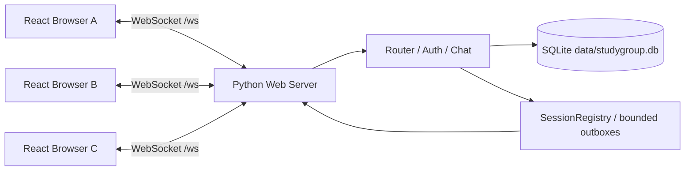

# StudyGroup architecture

เป้าหมายที่ผู้ใช้เลือกเมื่อ 6 พ.ย. 2026: **React → WebSocket → Python → SQLite**
Browser ทำ UI แบบ Focus ส่วน Python ตรวจตัวตน/สิทธิ์และเก็บข้อมูลที่ Server
Local เปิด HTTP/WS เฉพาะ loopback; LAN/Production ใช้ HTTPS/WSS

Python เสิร์ฟ build ของ React บนพอร์ตเดียวกับ WebSocket (`8000` เป็นค่าเริ่มต้น)
`GET /` ให้หน้าเว็บ, `/assets/` และ `/fonts/` ให้ไฟล์ public,
`GET /health` ตรวจ process พร้อมรับ และ `/ws` รับ WebSocket Upgrade
แชตและคำขอ Register/Login/Groups ทั้งหมดใช้ WebSocket ไม่ใช้ HTTP polling
Browser ไม่อ่าน SQLite โดยตรงและไม่มี AI key หรือ server private key

## ส่วนประกอบ

| ส่วน | หน้าที่ |
| --- | --- |
| `web/src/App.tsx`, `style.css` | React components และ Focus design tokens, dialogs และ responsive sidebar |
| `web/src/chat.ts` | Session ในหน่วยความจำ, rooms/users/messages/drafts/unread และการรวม sender echo |
| `web/src/transport.ts` | WebSocket, Request IDs, pending requests, deadlines และส่ง events ให้ controller |
| `server/web_config.py` | Web host/port, static root, Origin allowlist, TLS และ data path |
| `server/web.py` | HTTP assets + WebSocket adapter, connection lifecycle และ bounded outbox |
| `server/router.py`, `server/handlers/` | Auth/Chat และ validation เดิมใช้ร่วมกันโดยไม่มี logic สิทธิ์ใน UI |
| `server/sessions.py` | Atomic login, presence revision, live events และ cleanup |
| `server/database.py`, `permissions.py` | SQLite connections/transactions และสิทธิ์สมาชิก/ขอบเขตหลัง Join |

`websockets.sync` จัดการ WebSocket framing, handshake, ping/pong และ TLS
Handler thread ของแต่ละ Connection dispatch คำขอและส่ง application messages จาก queue
Thread อื่น enqueue ผ่าน registry เท่านั้น ไม่ทำ Network I/O ใต้ registry lock
SQLite ใช้ Connection แยกต่อ handler thread มี Transaction/locks ตาม Server เดิม

## Protocol และการป้องกันข้อมูลรั่ว

WebSocket หนึ่ง **text message = JSON envelope v1 หนึ่งรายการ**
ไม่ส่ง TCP length header 4 bytes ใน Browser ใช้ decoder/validation ร่วมกับ protocol เดิม
ปฏิเสธ binary, JSON ผิดรูป/duplicate keys/surrogates และ message เกิน 1 MiB
ปฏิเสธ Origin ที่ไม่อยู่ใน allowlist ก่อน Login Session ผูกกับ Connection
Logout/close/error ล้าง registry และประกาศออนไลน์ใหม่

Auth ใช้ Argon2id และ rate limit เดิม ไม่มี cookie/token ที่เก็บใน Browser storage
หนึ่งบัญชีมี Connection ที่ Login ได้ครั้งละหนึ่งตัว
`connection.user` เป็น Actor; ห้องส่วนตัวจำกัดคู่สนทนา กลุ่มจำกัดสมาชิก
ทุกคนดูรายชื่อกลุ่ม/สมาชิกได้ แต่เนื้อหาไม่ส่งให้คนนอก และ Join มีขอบเขตประวัติเดิม
Static root จำกัดไว้ที่ `web/dist` ตรวจ path traversal/symlink escape ไม่เสิร์ฟ `.env`/Database
หน้า production มี CSP และ nosniff; client แสดงข้อความเป็น React text ไม่ตีความ HTML

Queue ต่อ Connection จำกัด 128 รายการ, inbound queue 16 frames, handshake 5 วินาที,
auth 30 วินาที, idle 30 นาที, ping/pong 20 วินาทีตาม limits ที่กำหนด
Browser connect timeout 10 วินาที, request timeout 15 วินาที และ pending ไม่เกิน 128
ค่า Auth/idle ให้ดู `ServerLimits` ใน `server/main.py` เป็นค่าที่ใช้จริง

## Login และข้อมูลในหน้าจอ

1. React เลือก `ws://<current host>/ws` หรือ `wss://...` จาก URL ปัจจุบันอัตโนมัติ
2. สมัครสำเร็จให้ Login แยก Password ล้างออกจาก form เมื่อ submit ไม่เขียนลง storage
3. Login สำเร็จโหลดออนไลน์และกลุ่มทุกหน้า; ใช้ presence revision กันข้อมูลเก่าทับข้อมูลใหม่
4. Group invalidation coalesce ระหว่างโหลดและลด page size เมื่อรายการเกิน frame limit
5. เมื่อ private message มาถึงห้องที่ยังไม่รู้จัก โหลด room metadata โดยไม่แย่งห้องที่อ่าน
6. คำตอบเปิดห้องเก่าไม่เปลี่ยน selection ที่ผู้ใช้เลือกภายหลัง

ข้อมูล React อยู่ในหน่วยความจำของแท็บ ไม่มีการบันทึก password, drafts หรือข้อความลง
localStorage/sessionStorage Refresh/ปิดแท็บล้างข้อมูล UI ต้อง Login ใหม่
SQLite เก็บบัญชี/ห้อง/ข้อความถาวร และไฟล์แนบอยู่ใน `data/uploads/` หลัง Login React โหลด
Private rooms (`PRIVATE_ROOM_LIST`) และหน้าล่าสุดของห้องที่เปิด (`HISTORY_GET`) ตาม [history-files.md](history-files.md)

## ส่งข้อความ / หลุดระหว่างทาง

Draft แยกห้อง รอ server acknowledgement ก่อนลบ ถ้าแก้ร่างใหม่ระหว่างรอจะไม่ลบร่างใหม่
Response และ `MESSAGE_NEW` echo รวมด้วย `message_id` ไม่แสดงซ้ำ แต่ละห้องส่งรอผลครั้งละหนึ่งรายการ
หาก Commit แล้วหลุดก่อน Ack ข้อความอาจบันทึกแล้ว แสดงว่ายังยืนยันไม่ได้และเก็บร่างไว้
ไม่มี reconnect/retry/replay อัตโนมัติ กด Login ใหม่เอง บัญชีเดิมคืนสถานะในแท็บเดิมได้
Logout/เปลี่ยนบัญชีล้าง state เก่า Login ใหม่ล้างข้อความในหน่วยความจำแล้วโหลดจาก Server (คงร่างไว้)

## UI และขอบเขต CP06

ใช้ CSS จาก Focus: Sidebar 218px, Header 83px, Tabs 40px, Avatar 31px,
Body 12px, Secondary 10–11px, accent #6056d7 และ outgoing #6258cf
ใช้ Thonburi เมื่อมี และ Noto Sans Thai ที่ bundle พร้อม OFL เป็น fallback ไม่โหลด font ภายนอก
Browser ใช้ toolbar ของตัวเอง ไม่มี title bar จำลองในหน้าเว็บ
มือถือใช้ sidebar drawer; Enter ส่ง, Shift+Enter ขึ้นบรรทัดใหม่ และไม่ส่งระหว่าง IME composition

Search/history (CP07) และ Attachments/แท็บไฟล์ (CP08) ใช้งานจริงแล้ว; AI ยังปิดไว้จนถึง CP09 ไม่มีผลจำลอง
Cloud จริงเป็น CP10 เอกสาร config ไม่ใช่หลักฐาน Deploy
โค้ด Tkinter/TCP เดิมยังอยู่เพื่อ compatibility/tests แต่ไม่ใช่ entry point หลัก
อย่ารัน `server.main` และ `server.web` พร้อมกันกับ DB เดียว เพราะ registry แยกกัน

ดู [setup.md](setup.md), [protocol.md](protocol.md) และ [demo-checklist.md](demo-checklist.md)
อ้างอิง library: [websockets sync server](https://websockets.readthedocs.io/en/stable/reference/sync/server.html)
