# StudyGroup — แผนที่ระบบและเส้นทางอ่านโค้ด

แผนภาพอ้างอิงโค้ดที่ commit `9278781` ตรวจเมื่อ **8 พฤศจิกายน 2026** หลังนำ Tkinter client ออกแล้ว Client ที่ใช้งานคือ React ใน `web/` ส่วน TCP/TLS adapter ยังอยู่เพื่อทดสอบ backend ไม่มี desktop client ในแผนที่นี้

เริ่มจาก **[เปิดชุดแผนภาพแบบขยายดูได้](index.html)** หรือภาพ 00 ด้านล่าง แล้วเลือกเส้นทางที่ต้องการอ่าน ภาพแต่ละภาพมี source `.mmd`, SVG และลิงก์ **Mermaid Live** ที่เปิดพร้อมโค้ดเพื่อแก้ไขต่อได้ ลิงก์ Live เป็น snapshot ของภาพ ณ วันที่สร้าง; หลังแก้ `.mmd` ให้นำเนื้อหาล่าสุดไปวางใน Live อีกครั้ง

Roadmap นี้เป็น **ลำดับทำความเข้าใจระบบที่มีอยู่** ไม่ใช่แผนฟีเจอร์ในอนาคต สถานะ Railway อ้างอิงหลักฐานเดิมใน [คู่มือ deployment](../railway.md) ไม่ได้ตรวจบริการจริงใหม่ในงานทำแผนภาพนี้

## ควรดูภาพไหนก่อน

| ต้องการเข้าใจ | ภาพ |
| --- | --- |
| แต่ละส่วนต่อกันอย่างไร และโค้ดอยู่ตรงไหน | 00 Project map |
| ขอบเขตระบบและโปรแกรมที่รันจริง | 01 Context → 02 Containers |
| HTTP, WebSocket, TLS, TCP และ JSON แบ่งหน้าที่อย่างไร | 03 Protocol paths |
| Login, refresh, resume และ logout | 04 Auth/session |
| ส่งข้อความแล้วบันทึก/กระจาย/อ่านย้อนหลังอย่างไร | 05 Chat/history |
| ส่งไฟล์ผ่าน socket เดียวกับแชตอย่างไร | 06 File transfer |
| แชตเชื่อม AI อย่างไร | 07 AI summary |
| ข้อมูลสัมพันธ์กันอย่างไร | 08 Data model |
| ต้องเริ่มอ่านไฟล์ไหนแล้วตามไปไหน | 09 Reading roadmap |
| Local, Vite dev และ Railway ต่างกันตรงไหน | 10 Deployment |

สีในภาพ flowchart: **ม่วง = browser/client**, **ฟ้า = Python/processing**, **เขียว = storage**, **ส้ม = external AI**; กล่องเทาเส้นประในภาพ 03 คือ adapter สำหรับ backend tests ลูกศรระบุทิศทางของการเรียกหรือข้อมูลตามป้าย ส่วน sequence diagram อ่านจากบนลงล่าง เส้นประคือการตอบกลับ C4 ระบุประเภท/เทคโนโลยีในกล่องโดยตรง

## 00 · Project map — ทุกส่วนเชื่อมกันอย่างไร

[เปิดแก้ใน Mermaid Live](https://mermaid.live/edit#pako:eNqNV21v2zYQ_iuE-2VD5ThO7KT1hgJOmq0ZmiazvAZbPRSUdLI5y6JKUk69Nv99D0m9OUmHfklE8p7jvTx3R3_pxTKh3qTX7_cXuREmowkLTZnsflWyLFif3Sj5D8WGvSNzJ9WaXfFikTvpNJN38Yorw-Zni5wxXUZLxYsVi5S806Q-LHpns-vb8GLGFuXhYXTKZsShacDmu4LCWInCLHp_WyhjpYD4tCgOjP78c6QGr94LutOM5wkroYsBKGSuG3ltuCFAYIABpr7hHMtzmRsls4yUUzSTcqMDliieGvxfCW2k2gUsFRlhPb1sdBrFc11IZaC3-e4on9d7Xi99Kkkbdvnam1lQnoh8yQolN0KT7rjG-v1XX2ErzzLN4sY8tiGzkgkkv3p_Oq5VEFVdYhAx9pwl3HAr3VhnEbh3L_zFDlpz-HDz5_zN9Tt2M7s-vwjD2gt_zPobhrhuSR3cUdTYim8A8feg2NWAW4oQ0pxcBpzr2AllvCbkEjl6zmRpIvmZybucVKPKEiuGMg2KUDJAWIyMZWYVP2dbngk4A4VYO52hUQLk-C2ExZRvKZPweDts1IGOxnHKf3Tsm_mNROiCm3jltE1LsyLwOXZ3sKUNbq2J4wx6VkgakqAHdl1bMaMl-EEqYJlcijxginS5oQBZJU153GqxxOtqcUSstNwosbU5VJ56S1tK-G_oc0v4ioddFdVWreWNXzpyaeIqXjVgx90u1G3UwPNVma9ZWWSSJw6dIDN20YZA7AVA1Ehf9PB4w3GxrXewtJAya5FxTNpeXZACzbUtSp9Sy82Ia6p1XdEmgvaVKAK2FVpEIhMGdee4-7CclYu7CwdKp9FaZTj0W7NKyKm_TGx-rUKfIpaIJSoFYc7Elhhtcay7vK4qCqQEMV0uUH9a8yXZinJs7RC3kq54SgmrKtHKegZ2aVlJWyYBjujlvqrtxhNylhcuMc6KLsCy6CkAIZNduYoqT4haJuyJOmo8ITi9_Bj-cXU1nV3-deFsFW15VCKRgI2iCjT6NuWIQUmdYvjaZO4R2Nk8YDH-oxTAG1nmLnyeQm0VdYInlfiXLAj2i0fCldOVPEzBt2MWPK5SqR9inPffvMF2YF431S6Mi30vFMUritfNdSIvyv9zpiijTOgVw8xBwFt39qPVNe77EPWqAtUJ8Wz_ieWSad-YLwfXFm17ezsikujDD4te-PtbYcgVkbaT3rWngwRD4EdXLWikayv3i7Vuh264cbK-n-hBLYaGvgU3bEvm4qOdJSImX7RHw5dHbJqblZKFiH0zm89vQnZzHc7ZYDsctOlyupp5Vvl1GyLmt-3MclPBt8_Gp7akZxfhzfW78AJNqC77ByPyoX7wV2Zbqmc1LpP5hYXujWKf2wqCqCH7nOlPaGN0bAUTZ0c3iXcKZ6zAm0jwzNEG7Il2xvPSBtbprclVh_AA6S4yMpZXVde18vWxxcQZ1_o1pfgQsNPemk2e0Us6SdMAjJBrmjw7GY9H8WGAKSvV5NnRaBiNTvfAfuLX4FE67ICPR6cvopMaPDw6Ho5oH4zioxo7TseUtNijF0cnxx1sdBTvYZE6Ujli4uFpmg6TuIFHp6fR0biGj_nxySFv4Hg_BS4lQZtFH4RWBFwIXNsOfIsLbKkHth6D-r3nn3tcBD6rQVNJPiatriQKbKK8u-12nYzGlUXeC3obTEEuEjygv-DNuKINeuIEjRNzcNEL0I3x2PuFb0S2c_tTBV4ETMOPPu4VqRNyuPccZ5Ft1b3Jl-8EFkrYQX1u4-bEKkJ0D-ewtyNQkaIjcCYV3OqIeBY5kUzk1D0Zng5fjNyJxhjNkweXO0J5l8iWwN5pOk5P08idYvpLdbZePrLZHziDHtnizr7tTS4NQWX3wjQ9TuL28KGf8cnLaAzwvc1T_VvGRz8uwYk6k0JXOhIKCx7jjY8T0BVthOfrdmtkt1Zmk73lEWU2j0aVdO-ChTbt5qVVvhFKSTW17lihlGeaAts78MvKY-xKJHg69CbDU6u1apdXXOFRit3jw8qpZmc4vr8HH8F7Ge7yuNLTKwv7enktOH4abCqD_gMtU8SA) · [Source](00-project-map.mmd) · [SVG](00-project-map.svg)

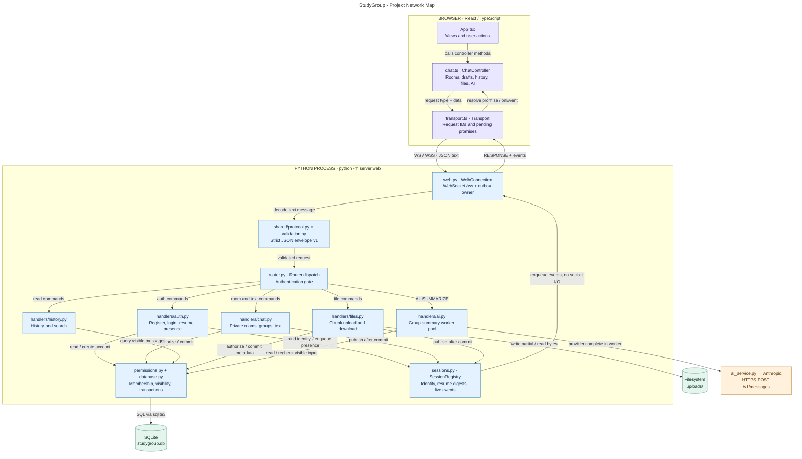

เริ่มที่ `App.tsx → ChatController → Transport.request` แล้วข้ามเครือข่ายเข้าที่ `WebConnection.run → decode_message → Router.dispatch` จากนั้นเลือกหนึ่งในห้า handlers ทางกลับใช้ `connection.enqueue` และ outbox ของ connection นั้น สำหรับ live events จะเลือกผู้รับผ่าน `SessionRegistry` ก่อนเข้า outbox; response ตอบเฉพาะผู้ขอ

Python เสิร์ฟ React build ทาง HTTP ด้วย `WebServer.http_request` จาก `web/dist` บน port เดียวกับ `/ws` รายละเอียดเส้นทาง HTTP อยู่ในภาพ 03 และ deployment อยู่ในภาพ 10 กล่องในภาพ 00 เป็น module/components ภายในโปรแกรม ไม่ได้หมายถึง microservices แยก process

จุดเริ่ม: [App.tsx](../../web/src/App.tsx), [ChatController](../../web/src/chat.ts), [Transport](../../web/src/transport.ts), [WebConnection/WebServer](../../server/web.py), [Router](../../server/router.py)

## 01 · C4 Context — ขอบเขตของระบบ

[เปิดแก้ใน Mermaid Live](https://mermaid.live/edit#pako:eNqVlG1P2zAQx7-K5fGCSVQQSNtRaS_abmNMbEOEPUmRJtc5NxaJndkOJUL97js7KU15kLZ38d3_fv6ffc495ToDOqHzeK6VgzuXKkKcdAWQxNVZc2Z0XZEBmcckaayDkvR0l2CsVvsWhaDcAUlp0n6m1C_mOXOWMJURmzMDlnhhQ0rmwEhW2JS-9pSWGyjN0m-3AbWbt6yZ0SsLZrBgFjISZIFcGXmLPMJxrx3e7_d3bp8plxtdSe4R082CTC_PW-oZKDBYbomunNSKFR3a1mXJjISNxysotm3uOn3SpZCFr_O5j9fXl8nhjyR5hNlU7_i7gj81WGT1LTQt6FPy9cthoHWkb1WGvpGXuKaA573taSEsuJ9vUzoaek4X-IWBwcnRy6Rn7P0P64I1unY4J0Iu9_d4nOSsgnN1pVcojkIxj2e6Vhn214sjgh7QEkzJZIYzeZ9Sl0MJKZ2k1F88lqZU4Px9YKUsmhCf-lHCvpmyAxwQKYIo1H3HG2SLcBmT-38sxHnypz7XhTZB9gpOYSR2ktc4_j3BcRwt4nFfMNMmA9OTjIbDmB8FSSEV9DPROHoTh4wFrsOR9DePRdRtjo_Gyd2sGIqxWIQs406b2c3yiec2EQw98RJyL3ejtANE9jcU4iTj2-TjPvnodDHE4rW_p0Kv8FUa154-r83tw01K2zEySCrGpfK-j4cYMkzdbEOxD-WuLC7YAvwPY-JMDetwWPhYFIcWXkpjtJn6drxI4M8FULQyrOpq_EpmLsdlNPbUEqxlS_jMzFIqjJ4cdU09RKLheo3zyGqnk0bxjkPrMOPvJFsaVnaG_gJtN8dM) · [Source](01-c4-context.mmd) · [SVG](01-c4-context.svg)

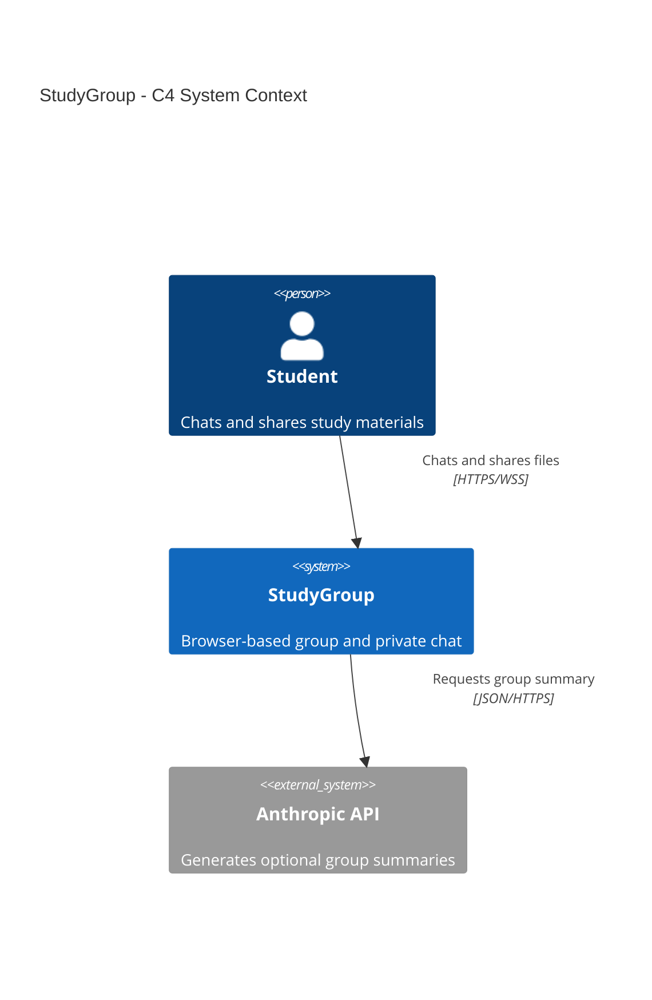

นักศึกษาใช้ StudyGroup เพื่อแชตส่วนตัว/กลุ่ม ค้นหาประวัติ ส่งไฟล์ และขอสรุปกลุ่ม AI เป็นบริการภายนอกที่เรียกเมื่อผู้ใช้ขอสรุปและ server ตั้ง provider ไว้เท่านั้น

## 02 · C4 Containers — อะไรรันและเก็บข้อมูลที่ไหน

[เปิดแก้ใน Mermaid Live](https://mermaid.live/edit#pako:eNqNVVFv2zYQ_iuE1gcXS5rYkZLWwB6cdN08ZIsbJcsGGBgo6mQRoUiVpOoKgf_7jqRky3HS7UnS3Xffd7w7np4ipnKIptFVfKWkpVyCXkpCLLcCSGqbvP1Fq6Ymx-QqJluIcZgFPpUcGQSBtEdkGaXhdRm5j3sDhtgSyBoywqUFXVAGy-iti01bY6H651I1Mqe69STtyin1PEEX4eTJBZCd-MjU1KEutVob0ITWteCMWq5kUL4Fyiw5IXdtDSnTvO4zmhMqc8zluIJK6ZYwwTFdYiy1fWJ7OqC_gnaRi9aWSh4q4dGMYo9gzTvTSoaaARm8KfJyRn69u1t44QfIUo8mTFUVWsyh6MdsZL4IbsERzHZ6JKeWZtRAR_35GjGoJxSjghRcdI4ZY1hTa46IVqrCRwXG0BW2wmVQgaWO6EXdphaK5sazWEtZWYXiKI3xgf16q2Z8A4N1QbXlaHcKdZMJbkrIPYpkrYX-lJtB43_-ZkdU2lKrmjOv2H-Q2WIeaG9qd3Dknc2JabBg2LFaq688xxkNlLcgdvPXjcXcjRoOgCFrbstA1Y_K_XwY6PC7HqeADdl2xpcWq-FDnPshHaVvyY--m_g25Okodn3DAcxDwR0dx1Q0MKVdv507AM9QAtv4AtGgEQ8akYFKB9JdZ7raOtinbUfI_OTmBcq9Wt_ClwYMZuUvXFdb3nP9lt78ceJOmXY89zWODCBbalsBz-r9RhWFAfvXT8voOEkcQ2f521nGp69wDEs_pJicPqd4_xrFs6p_P5HJf7BsSz6gOT9gSb5PMijygOYgmf1UrmmrGov3sOCr0RsWpyWtYS5v1RqhEx_K4n5P9vaxp4iOogp0RXmOC_xpGeGyrfCiTpdRtyiWUYH3-xOtuGi9fabxnmLNqDTHmDUvPMjH_YkjQDPhpmD69D8Da83drbxSQmkP-wE-wHmx57yDb3YAmMTjLL4YAi7xYoAeQM6TJGanHiJwNQ0944vx-9h7DF4oX5KheFyMO3FcAbiS9rxFUlwUmffidlD68nF1kHNw-IQOcvG-108jlQWkHAoWxVnOds7n52TnH7IEgzeuT0KtWYl7NFSfNThRfSe56ThySGvKuHR5TxI0aSofd6bYmUpbiWuagXB9tLqBjS8WXnjpfr6OvOJaKz1zx3GgggoDCFprWncx7ovnbnlOxxeOtfuJ_E71iuPPbXp22h1qaxknmw3OI22sSvFP2PFEjZ_xj5yuNK26hP4FrxvSdQ) · [Source](02-c4-containers.mmd) · [SVG](02-c4-containers.svg)

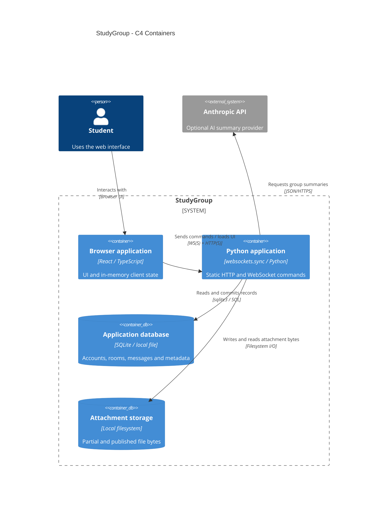

React รันใน browser ส่วน Python เป็นแอปฝั่ง server หนึ่งตัวที่มีทั้ง HTTP static และ WebSocket API SQLite เป็นไฟล์ที่ Python อ่านผ่าน `sqlite3` โดยตรง ไม่ใช่ database server ผ่าน TCP และ `uploads/` เก็บ bytes ของไฟล์แนบ แยกจาก metadata ใน SQLite กล่อง storage แสดงที่เก็บข้อมูล ไม่ใช่ process เพิ่มเติม

Browser เก็บ rooms/messages/drafts ใน memory ของแท็บ และเก็บเฉพาะ resume token/expiry ใน localStorage; server เก็บ online sessions, resume-token digests, outboxes, uploads ที่กำลังทำ และงาน AI ใน memory ข้อมูลเหล่านี้หายเมื่อ restart แต่บัญชี/ห้อง/ข้อความ/ไฟล์ที่ commit แล้วอยู่ใน storage

จุดเริ่ม: [WebServer.__init__/start](../../server/web.py), [Database.connect/initialize](../../server/database.py), [session.ts](../../web/src/session.ts), [schema.sql](../../server/schema.sql)

## 03 · Protocol paths — อะไรทำเอง อะไรให้ library จัดการ

[เปิดแก้ใน Mermaid Live](https://mermaid.live/edit#pako:eNqNVm1v2zYQ_iuE-mVD5Th-ixNvKGA3adetTYzIbTHMQ0BJJ5uITGokZddr8t93R5Gy3W7AvhgW74V3z3Mv_BplKodoEnU6naW0wpYwYYmt8_1breqKddhcK6syVRrGZc6mOa8saDZTtcy5FmCW0pkWpdpla64tW8yWkjFTpyvNqzWrtNhwvf9jGc3v332Y3v_OlvX5eTpmM612Bl3pGu_dwDL6k-wYS5tzNAgaL9ld8nOqu6-ub5OYLV7Pu-_mLprF-4RtuOQryFkKGAHjVdU6WltboZdfFov5D8mP4doKtdEjNwaswT9r4KVdO_c7SM-qfVAk8wcNf9VgbOtzZ7xH9rHC_HJg3Z1Bi37vqs8-Q5qo7BGs83anxUpIlq0he4xZoflGyFXMKvztVkquwpXGmZgzs5cZK0WqEa32PpBbzKsCvHVaVQhmQwbb9kKYvyZ3t8zCl-bSLWYkcvyx-4rSzLnlTTQSWmesQlA_I3RgDKLxLfKs03n1tIze3ixYN9zSbfA6fBdKHn82KC6jJwfbv7lbaC5NpbQ9y5SUkFlS3pkAq9eiREJcP7FU5URHv38xZD32QczIJmRBliDzk2KzyBUxNJu-_u3m9potbpIFm15P54ub-xCrVJbZNbThVZwC9xBU4CrP-ena0jzQARaFw_ATaFEIrDUqQao9UnMmrb3NqOTQ7RZ0d8OFpIJ6yXzKQsngi8wb5pFzY0FiJF22U_rxyBsVDVFvsLEg7wb2g49hJ91bTESsOgiE4JKVIFd2jRd-XLzpXLraOEktcIGX9876LwMkTR7IDeGLKbS5eH0N2fYBvvDMYozuo-IUOqm7GI-42PJSYNVhqhh44gJnxmqBtjRqMgzOq4D34nLB3mHcDxfsBCTIiL_BOKawuHI8FhKFkpdlk_2tYh4AL1fyhNed0KG0cZRZx-u9-3OWC4OsZ-vQuAVwW2t0hEOlBG2c_wTzwpA3G5o0Ej-aCagBq1gaEkmreRZmAxfUo--oRbeCwslKAdIGiLl4oKoQGQT2al1it5_5CcPmd1iqCsuG0Xhp5l0CFdcIFMOwU5q4R4Xkr217umEKAUaQH9rOfjrig9QdW8esHog8VTx8eW13wNp5-ORBPcDr9RCCpoqRj3JPilyQUlbiCLmGIiwEVoiynLyAK7goihgrRD3C5MXFaDTMzmMscqUnL_rDXjocn1i7Um1Mi14xKEat6fjysn-ZB9PB-eBqOPDCTs6phTTfT0ZseOIvU8i7D2WIHg-hDIbjy_Qi-Ov1B70htKahymIad_HOxIfZ2qR30KS-i7GX4gZ7SuAgPMAcNyjGXLiYljKKow1onCE5ruevOJPWQFtysoxSbvBPvIxoCL_BvUI44_lUC17GzOCg7RiaVU7J2X3CXc3TEtd1NPn6Pw19Jq8JAKfmyToWLnBeHyl4wo4UZkpjMxypNAw7lVJIOJb0xr3LoZMYLGN6X5xc7uhpUgJtxam0GBXjInVS7EmlZ4-r72JuBC6g72Jxsv_OBpcGoMvjC4tikGcH4bd5ZhdX6QiNn4mn8Dhq0M9qXA-BSWG8jxwSbEZ8HaCkP8IjXJiPh6MhHa3tpnzP8alDPFpdw7MDC3tSZtA43witlZ5SOqRU8NIAKu1wP3ob-hI5Lb1Jb0xe_bT4wDU-WPB0cO6Tak96o-dnrEdeW5XgM8X7ieqKxvi14Lh9Nz6gfwBgtHwz) · [Source](03-protocol-paths.mmd) · [SVG](03-protocol-paths.svg)

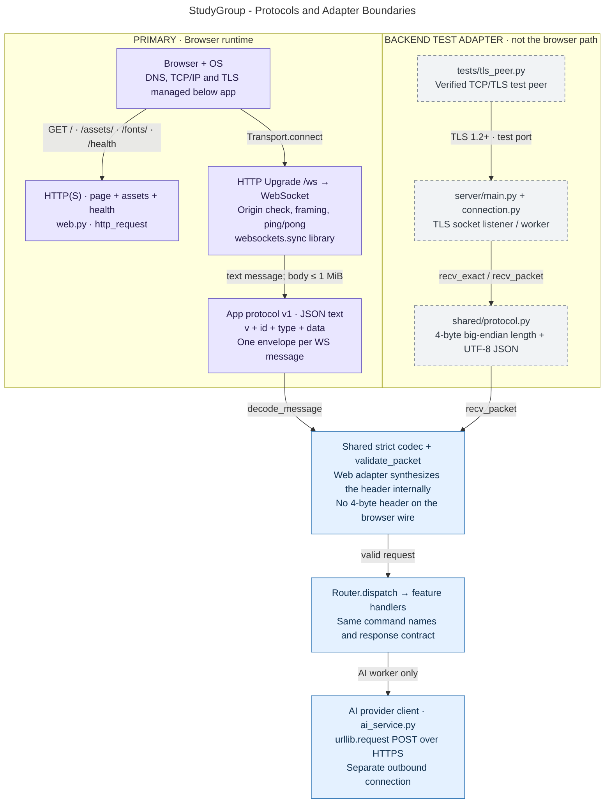

| ชั้น/รูปแบบ | implementation ในโปรเจกต์ | ผู้รับผิดชอบ |
| --- | --- | --- |
| DNS / TCP/IP | browser/OS จัดการการเชื่อมต่อ; TCP test adapter ใช้ Python `socket` | ไม่ได้เขียน TCP reliability/congestion control เอง |
| TLS | Railway ยุติ public TLS ตาม deployment ที่บันทึกไว้; direct TLS ใช้ `ssl.SSLContext` ตั้งขั้นต่ำ TLS 1.2 | [web.py](../../server/web.py), [web_config.py](../../server/web_config.py), [main.py](../../server/main.py) |
| HTTP | `GET /`, static assets/fonts, `GET /health`; `/ws` เข้าสู่ Upgrade handshake | `WebServer.http_request` บน `websockets.sync.server.serve` |
| WebSocket | browser native `WebSocket`; Python `websockets.sync` จัด handshake, framing, ping/pong; server ไม่รับ binary app messages | [Transport.connect](../../web/src/transport.ts), `WebConnection.run` |
| Application protocol v1 | JSON `{v,id,type,data}`; request ID จับคู่ผล, response/error รูปแบบเดียวกัน, event ไม่มี ID | [message_types.py](../../shared/message_types.py), [protocol.py](../../shared/protocol.py), [validation.py](../../shared/validation.py) |
| Auth/session contract | Argon2id, rate limit, connection-bound user, opaque resume token | [auth.py](../../server/handlers/auth.py), [sessions.py](../../server/sessions.py) |
| File-transfer contract | `FILE_BEGIN → FILE_CHUNK × N → FILE_END`, `FILE_GET` ตาม offset; Base64 ใน JSON และ SHA-256 | [files.py](../../server/handlers/files.py), [files.ts](../../web/src/files.ts) |
| External AI HTTP API | Python `urllib.request` ส่ง JSON ด้วย HTTPS `POST /v1/messages` | [AnthropicProvider.complete](../../server/ai_service.py) |
| SQLite access | local SQL + WAL + transaction; DB connection แยกต่อ worker | [database.py](../../server/database.py) |

**บน WebSocket:** หนึ่ง text message มีหนึ่ง JSON envelope, UTF-8 body ไม่เกิน 1 MiB ไม่มี custom length header บนเครือข่าย `decode_message` สร้าง header จำลองใน memory เพื่อ reuse `recv_packet`; `encode_message` ตัด header ของ shared encoder ออกก่อนส่ง

**เฉพาะ TCP/TLS test adapter:** หนึ่ง frame เป็น `4-byte unsigned big-endian N | N-byte JSON` ใช้ `recv_exact` รับให้ครบแม้ TCP แบ่ง/รวม chunks ชุดทดสอบใช้ [tests/tls_peer.py](../../tests/tls_peer.py) ไปยัง `server.main`/`server.connection` นี่เป็นทางทดสอบ backend ที่ยังเหลือใน repo ไม่ใช่ client อีกชุดสำหรับผู้ใช้ และ registry ของ adapter แยกจาก `server.web` จึงไม่ควรรันสองตัวกับ DB เดียวพร้อมกัน

**Request / response / event:** `Transport.request` สร้าง random ID แล้วเก็บ promise ใน `pending` เมื่อเจอ `RESPONSE` จะ resolve/reject ตาม ID ส่วน `USERS_UPDATED`, `GROUPS_UPDATED`, `MESSAGE_NEW` ส่งเข้า `ChatController.event` โดยตรง Request ID ไม่ใช่ idempotency key; การส่ง request เดิมใหม่อาจทำให้เกิด write ซ้ำ

### คำขอทั้ง 18 รายการตามเส้นทางจริง

ทุกแถวเข้า `Transport.request → WebConnection.run → decode_message → Router.dispatch` ก่อนถึง handler ยกเว้น direct backend tests ที่เข้า TCP adapter แทน

| Request type | จุด dispatch/implementation | ผลหรือเงื่อนไขสำคัญ |
| --- | --- | --- |
| `REGISTER` | `AuthHandlers.handle` | validate, hash Argon2id, create user; ต้อง Login แยก |
| `LOGIN` | `AuthHandlers.handle → SessionRegistry.login` | verify password, bind user, issue resume token; reject duplicate live password login |
| `RESUME_SESSION` | `AuthHandlers.handle → SessionRegistry.resume` | web server เปิดใช้; digest/expiry ตรงจึงแทน connection เก่าได้ |
| `LOGOUT` | `AuthHandlers.handle → SessionRegistry.logout` | revoke resume token, remove presence; Router cleanup uploads |
| `USERS_LIST` | `AuthHandlers.handle → registry.users` | คืนรายชื่อออนไลน์ให้ผู้ Login แล้ว |
| `PRIVATE_ROOM_OPEN` | `ChatHandlers._handle → open_private_room` | คู่ผู้ใช้เดิม reuse ห้องเดิม |
| `GROUP_CREATE` | `ChatHandlers._handle → create_group` | ผู้สร้างเป็นสมาชิก; commit ก่อน event |
| `GROUP_LIST` | `ChatHandlers._handle` | รายชื่อกลุ่มและสมาชิก; keyset ด้วย `after_id` |
| `GROUP_JOIN` | `ChatHandlers._handle → join_group` | join ตัวเอง; บันทึก visibility boundary; join ซ้ำคง boundary เดิม |
| `MESSAGE_SEND` | `ChatHandlers._handle → add_text_message` | actor จาก connection, member-only, commit ก่อน publish |
| `PRIVATE_ROOM_LIST` | `HistoryHandlers.handle → list_private_rooms` | เฉพาะห้องส่วนตัวของผู้ขอ; `after_id` |
| `HISTORY_GET` | `HistoryHandlers.handle → search_messages` | `before_id`; หนึ่งหน้าคืนลำดับเก่าไปใหม่ |
| `HISTORY_SEARCH` | `HistoryHandlers.handle → search_messages` | keyword/date/kind; หนึ่งหน้าคืนใหม่ไปเก่า |
| `FILE_BEGIN` | `FileHandlers._begin` | ตรวจ member/name/size/hash แล้วสร้าง partial transfer |
| `FILE_CHUNK` | `FileHandlers._chunk` | owner/index/decoded bytes ถูกต้อง; append และอัปเดต hash |
| `FILE_END` | `FileHandlers._end` | size/hash ตรง → rename → transaction → file message |
| `FILE_GET` | `FileHandlers._get → require_attachment` | ตรวจสิทธิ์ทุกครั้ง; คืน Base64 chunk ตาม offset |
| `AI_SUMMARIZE` | `AIHandlers.handle → _run → provider.complete` | กลุ่มเท่านั้น; input ที่เห็นได้; response เฉพาะคนขอ |

### Server events ทั้ง 3 รายการ

| Event | ส่งเมื่อ | ฝั่ง browser |
| --- | --- | --- |
| `USERS_UPDATED` | Login/resume/logout/connection cleanup; มี revision | ใช้ revision ใหม่กว่าอัปเดตรายชื่อออนไลน์ |
| `GROUPS_UPDATED` | สร้างกลุ่มหรือ join ใหม่หลัง commit; ไม่แนบเนื้อหาแชต | invalidate แล้วโหลด group list ใหม่ |
| `MESSAGE_NEW` | text/file message commit สำเร็จ | รวมด้วย `message_id`; ส่งเฉพาะผู้รับที่มีสิทธิ์และออนไลน์ |

อ้างอิง implementation: [Router](../../server/router.py), [AuthHandlers](../../server/handlers/auth.py), [ChatHandlers](../../server/handlers/chat.py), [HistoryHandlers](../../server/handlers/history.py), [FileHandlers](../../server/handlers/files.py), [AIHandlers](../../server/handlers/ai.py), [types.ts](../../web/src/types.ts)

## 04 · Auth/session — ขอบเขตตัวตนกับอายุ connection

[เปิดแก้ใน Mermaid Live](https://mermaid.live/edit#pako:eNqNVk1z4jgQ_Std7GWmApmQCWGHw1RBYLOpSkIWh-RCVUrIbdAiSx5JhjCp_PdtSeYzs1t7s6XX3a_7Pcl-q3GdYq1TazQaE-WEk9iBxJXp-trosoAG3OqZUHUYoS1zBKZSv6JLN1EhxOKPEhXHvmAzw_KJAmCl06rMp2j8W8GME1wUTDnoAbPQM3pl0cCkPDubtoHPmTt19hj67KHPOL3SSiF3Qiv4AiOq-zFr10O7pZv_Sewkmg-5-h6Q_HUrHMIJPDBrV9qkH2BJgKG1VGyEM2GdWXtMr_H9-3MHhgUSh5WFT0MjaCawZFKkzGEKzMGcats5W-DnvZDb4fXNPbyV1K5iOdapXKxdB5G-e-AzAbsdSIUtmONzoDZLRQOcI4nBQ3K-nYAP6MaAp6o2CFWUrg7GP0uRC3pm_EcpDBIlOwcrtdvE9YmR1guSVWmTU4aflH5HbolGZGvomplW5yL1Uf1GLDf2gn2BGSrCcNgj6IXJmJClwU2ZpAPSm-bTjnk9lCGaaAtNnglDSiK263ROmaRcw1SotEJap6kFpxc09FTM0DpqFUbduxgZ5ztQZL4SYTRIHob3yQBWws2roBPA10KYdR08Vxgng1HyMn7odx8H_Th5ytHr7GK9tQsi6N0MuKT-NkoSykZbkFHBsiXaoyKem9TUREK02Qz3PBAL394kj3W4Hg3HD9Xzw-jmibi8jIbDu7DkY3Th6KRlxIKsYGhc2psudOXLprGsR27z3-MquPLEdzK-G7wkgyS5GZLtTDiyLyFka7it5bYOip347ncmishKzJjnQM1tzs8RWUl5NUe-2Mi1E8BgIRkNtTCCmpJiiUem_g9FT6As4iHbaLPpopIPo1NE6g3pQjWpWUqKGTI0-YiCfQiq4GgmHQxeC0mH3vnzORw_7sZJ-a4kMrM_7KirXB8MPQbC2_FQZbgaiQJ1YQ-nOMIlpdtMzmCuaQxaSaF25H_BZHwTWwCW0dW3yUw3jsO8CBVQWoRE8wU64FKTU3eUQt1fVfIMHCPXRnErzfbmdK-ppvYT7NVDlgALipL7I5k2pGxt65tR04aj6xQCBxq0PExuTw_zdkPewTVZfzACbpC6pDCyIue6pPuYKK9PoV96sfwENpdnvF1AWMr_N5kIU8pcq9dypEtNpPQxe5vU6NDnOKl1JrUps_RQn9QyrdwfLBekpV_vGsEkkWfKNqy_-gIoxD0x2ptKmmSt8_Y_A8ncOTPrKy21CbDf8BteZgebj_jq9gDnF83pRXsf0KP20OxBLlutC34WIF6__Z1mu_n7RdixSMcpPSp-kTWr4iSVE4e7WStrZ9Owyzidn95i9oFz3AiEPnAJe__ejSKRKeV-wSz7mvLd5nGf_PLbtEXB714nqVf0V2BcnD4vyV0bJYWtcqSYFIwL5Xmft2jJMLXYLV34pbnL5S2b0gGhFWdKfA_Dij8sMXkujNGm69vxoIzRYSLQyrCiivFvInVzem22fdacPgV0xd8xQy6k1a9nVVPblWbr_Z386P-DkrXiVZ5avMiqH6WK0D87NDBF) · [Source](04-auth-session.mmd) · [SVG](04-auth-session.svg)

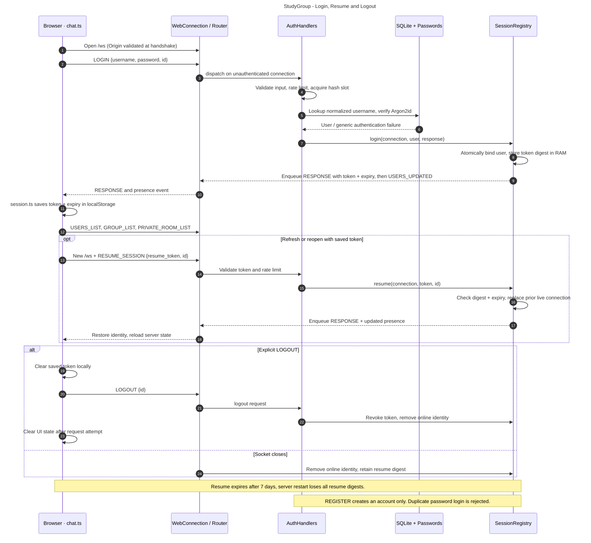

`connection.user` เป็น actor ที่ server เชื่อถือ ไม่รับ `sender_id` จาก client เพื่อเปลี่ยนตัวตน SessionRegistry ใช้ lock ทำให้หนึ่งบัญชีมี live connection เดียว; password login ซ้อนถูกปฏิเสธ แต่ผู้ถือ resume token ปัจจุบันสามารถแทนแท็บเดิมได้ Token เป็น random opaque string ไม่ใช่ JWT; server เก็บ SHA-256 digest ใน RAM และ browser เก็บตัว token/expiry เป็นเวลา 7 วัน

socket close ล้าง online identity แต่ยัง resume ได้; explicit logout เพิกถอน token ด้วย ส่วน server restart ล้าง registry จึงต้อง Login ใหม่ การ resume ตอนเปิดหน้าเป็นพฤติกรรมต่างจาก reconnect กลางแชต: โค้ดไม่มี auto retry/replay ของข้อความหรือไฟล์ที่ยังยืนยันไม่ได้

อ่าน: [ChatController.restoreSession/authenticate/logout](../../web/src/chat.ts), [session.ts](../../web/src/session.ts), [AuthHandlers.handle](../../server/handlers/auth.py), [Passwords](../../server/passwords.py), [AuthRateLimiter](../../server/rate_limit.py), [SessionRegistry](../../server/sessions.py)

ดูพฤติกรรมใน: [test_auth.py](../../tests/test_auth.py), [test_web.py](../../tests/test_web.py), [session.spec.ts](../../web/e2e/session.spec.ts)

## 05 · Chat/history — commit ก่อน event และใช้สิทธิ์เดียวกัน

[เปิดแก้ใน Mermaid Live](https://mermaid.live/edit#pako:eNqNVVFv4zYM_itE9lgna3pJuwa4A1zba7Ne2iLOXTEgQCDLdKzVlnyS3F5W5L-Psp00TTdgD3kw-fEj-ZFUXntcpdib9Pr9_lJaYQucQGzrdHOtVV1BH2KUqQcPdVIIkwOTKcyRpXAjjFV6s5RNoMEfNUqOoWBrzcqlBGC1VbIuE9Tuq2LaCi4qJi34wExDixqW9elpcgFBzmygpNWqKD4GPLqAR0wIIZFboST8CnNV24_QwEEd2w1VSlTmGBA6QMosS5jBQbWBE6hQl8IYojVkOA6I22ob_xzX1LbeUHrKnqif-IH_ysH92uZKi78xBY3kECitA_r9L18eJzCL4ti_jlZxdBfCq1aqXAnS2OJP64FItw76SNBgAqkwFbM894Bx0hs-A9-LMKhNK0DQYn3-oxYaoWpntSoUf9q5wwlcRdfTO5jOZlE49ReRR6U1-FWJbkoeTO_iaL6Aknpla3SRYb9l7kyg1Qvp9SyMSAp8aw2mofEguJ_Npos2YdtnJGkraoR5FD_cEzm8dkRbyKgX06zArsJ4sit8r89d9AhWtfOxlsQsxDOC69pldIHxUaaWEpDnqhWR3P7krYCTQ-49wRUh9r286duwmeMIv6WcoSZBks1Om2aCvECmoZY8Z3JN9aaaZRboRzX5wa0Lv1MWQT07g0dDCYXpEnawVkXgTEKhDLqwAdwiVi2ZB6kCqWxzXn2NVcE2g4PVupnGi_v5n6vraAEk8e4zjvx5cHOwawnSBNqiB4PBfuOoou6wd_dDF3o2vDwjLZjm-arr1rTb0QT4VVU4GdwSmVxUJPJfSkhIVC1Tpt2FaXoxNsCsZTwvnciZKLrjDbsJ3uLGoKVTIlVPQNIprPY1_usoS3cWpDGNwC0yGgst8khhp4RGW2tpQBUp4fqZ0IR-ETanMl1GDzqBdkCJL3vg4D1p4NGmXs_vvz2sgnlEh0SPQfv5xz3dF1clLWunb-uIV98eQgKGIOQzKwS9Pu56l7Ln9UrabSZSeoBflz2bY4nL3mTZc4_Tsuctexk9ir-zUhSbxu5rwQoPDJOmT2cgsgbUxH1n5KOzNAR8_Z-BlRYlTShQhdIN7Be8xPPsnXNBozgAnI2GyejiEHClNN3cAeR8PB7x0wZSCImHnuHF8LdR4zFIe58eJR9lwy45bYcV773ZOLvIksbbvIVXT-sPNbeOpqAPtTS-_-6GjgqJ8jBhln1K-ZvzuE9-fpmMKXjr5lSoF7p6bVv1ea2f95MUpuNIMa4YF9LVfTYmk2by6c00cqbclsVXlmDh5mh1jdtGrPbvtSUvhdZK-64dB8pYYZBAL5pVXYz7EqnN6XN44Vi7s50xvRaSrJ9Ou6b2luF4u6V9dM9KvJG84-nVFW3r7m-9K-gfGPS81A) · [Source](05-chat-history.mmd) · [SVG](05-chat-history.svg)

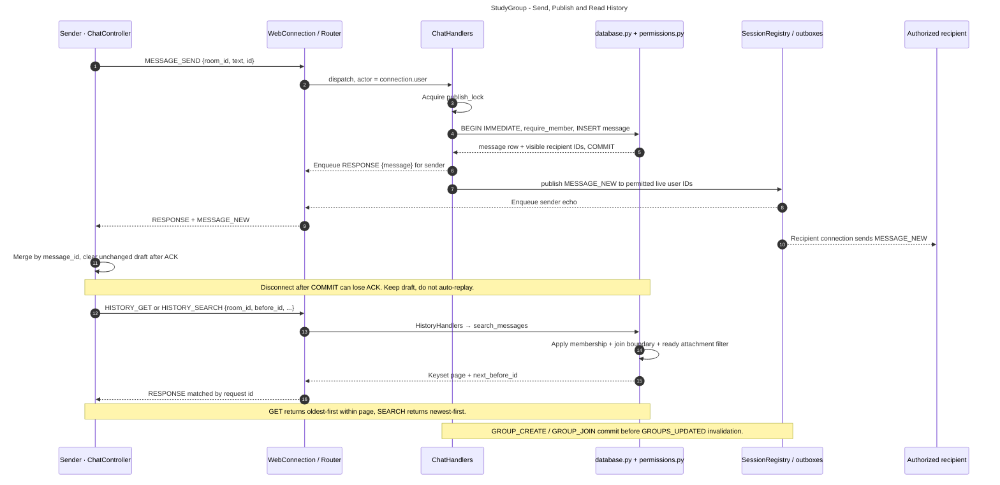

`ChatHandlers.publish_lock` ครอบการเขียนและ enqueue เพื่อรักษาลำดับ commit/publication รวมถึง boundary ของ join ฟังก์ชัน `transaction` ใน `database.py` ใช้ `BEGIN IMMEDIATE` และ savepoints เมื่อซ้อน transaction ผู้รับ `MESSAGE_NEW` มาจาก `message_recipient_ids` ซึ่งใช้ predicate เดียวกับ history/file reads

สำหรับกลุ่ม ผู้ join ใหม่อ่านได้เฉพาะ `message.id > room_members.visible_after_message_id`; กลุ่ม/รายชื่อสมาชิกมองเห็นได้หลัง Login แต่เนื้อหาต้องเป็นสมาชิก ห้อง private ตรวจว่าเป็นคู่ที่ระบุใน room ด้วย Search ใช้ SQL `LIKE` แบบ parameterized และ escape pattern ไม่ใช่ full-text search service; วันที่ถูก normalize เป็น UTC โดย `utc_bound`

pagination ใช้ message ID เป็น keyset ไม่ใช่ offset เพื่อให้ข้อความใหม่ไม่เลื่อนหน้าประวัติเก่า Browser รวม ACK กับ sender echo ด้วย `message_id` ข้อความจึงไม่ซ้ำใน UI แต่หาก commit แล้ว connection ขาดก่อน ACK ผู้ใช้ต้องตรวจประวัติก่อนกดส่งใหม่ เพราะระบบยังไม่มี deduplication สำหรับ repeated writes

อ่าน: [ChatController.send/merge/event/loadHistory/search](../../web/src/chat.ts), [ChatHandlers](../../server/handlers/chat.py), [HistoryHandlers](../../server/handlers/history.py), [search_messages/join_group](../../server/database.py), [permissions.py](../../server/permissions.py)

ดูพฤติกรรมใน: [test_chat_integration.py](../../tests/test_chat_integration.py), [test_history_integration.py](../../tests/test_history_integration.py), [test_permissions.py](../../tests/test_permissions.py), [chat.spec.ts](../../web/e2e/chat.spec.ts)

## 06 · File transfer — bytes กับ metadata คนละที่

[เปิดแก้ใน Mermaid Live](https://mermaid.live/edit#pako:eNqNVm1v4jgQ_isj7sudFtpCgW6RbiVood3blvaa7u4XJOQ4E2LVsXO2U8pV_PcbO-G1Omm_APG8eOZ5npnw3uA6wcag0Wq1ZsoJJ3EAkSuT1Y3RZQEtmAiJ8GyYsika0K_04TKEq4w5-IlxpPkLupkK8Rb_KVFxvBZsYVg-UwCsdFqVeYzGPxXMOMFFwZSDETALI6OXllLOyrOz-AI4ZT1xFk4hpWst_TyOmvioJ126ENRpX3ZChbdMJRLNB_dH714WUrPEnp4EC5PwaXt07H_t_aO_74RDKqJAkwtrhVYfEkfBEYPxCRfCOrPyPqPWly-jATwhS0IPvshOvws9uBejJnAmeSkZZY9uh61Or7-JmQxg8vVuPB-Nb75O4d1onc9F0gTFcmyCFf_6z4xRxNqHTCjkegCGABcG5zluEPaGxwFcGfSXELREWMsnSWDTvS-rcq1qdTW54T6elepl7u-DP-G8A99C1f4wQCC1LuDBJGgoYXUMv5NOnIZuqAYt0ScUpFIsMveHjzls8Or2-_QbvB9cKlSCb01ImGMDGDGL_e66ipxUkVcZ8hfgWinkjhAHvVRo6kAg7iFBL-QE4hW1zXWp3C4B4TEsClSV1TaJ_cSjIxQ3mKNyBErGbLaJqCkcR48P02hMZCBH8YpJqInSHHM2nl4fNLRliBx-oBHpCtJSysBiKHaP-7q-VJY2I12mdqU4fRv0nHlYawoXSA1T0QlYpwn8ubfvKeE7IWHC_EBRxlLYbC5pNL1EeACPcU5qJS51ngtXaTOnE7bAcB9LVsCcYzzziOzrYwfExn8pXLbnTHkc8-RtG48G8FhVAffjKBrejOfT8U9gqR_bqoKtmq6JSz-MRE7Fnk5Ti24jq86vyepm_Azvu5KCrKpEe0ram5idaxNYUcgVZMIju4JXYUUspHArMGU1KVuawlgTxLm2Dtqdz348DlVTqTdImWANjH-qB5d-JFrhkYgoZmgtzS_xUcvztdJMrRKae_aKMJI6JsBogciwaKbaQ-XX8ahJIAxJXx5YkpcFZhD-ih6m4PDNAY3L6dKebEoTlq6nYRFq0YTnu8g_mVVB-AYJF9q4k8MLJk1qfWyMNrQTpV7Q9qUfibD1QBKoOTnSolWpUEQ6qbResFT8ErGg8fL7mW5-K4RZUf5Gs5HTdmUioZfP-6xB7xTSc2Mwa8RU5qzRnDVSrdyE5YL69edDQ8vLg6Fsy3qEglOI-8HIRgBacnz_xcDCiJyZ1ZWW2gS33_AS--mB8Zng23PodNtx92LfYaT9Ktxz6fd6XX4WXKRQuG9pX7Q_d4PF0q5SydHl3bRdX04zQnv6wJr20os0DlbGSaWjl8WHmitDKOhDLcH2_90ooppS7l-YpucJ3xmP--T9y7hHwWvPk9RLWjzGVejzkhbWhklh6xwJRgXjpDmydHp0RFp72R11_VHmcnnHYpSeR2dKXAewqv8UVfJceBkOfTveKWXSIjktDSvqGP8kEpfRY_vCZ62X1j0zC6Ho9Pysbmp70u6t16RH_1clovVb52lUb4n6v0xd0H-fDw9w) · [Source](06-file-transfer.mmd) · [SVG](06-file-transfer.svg)

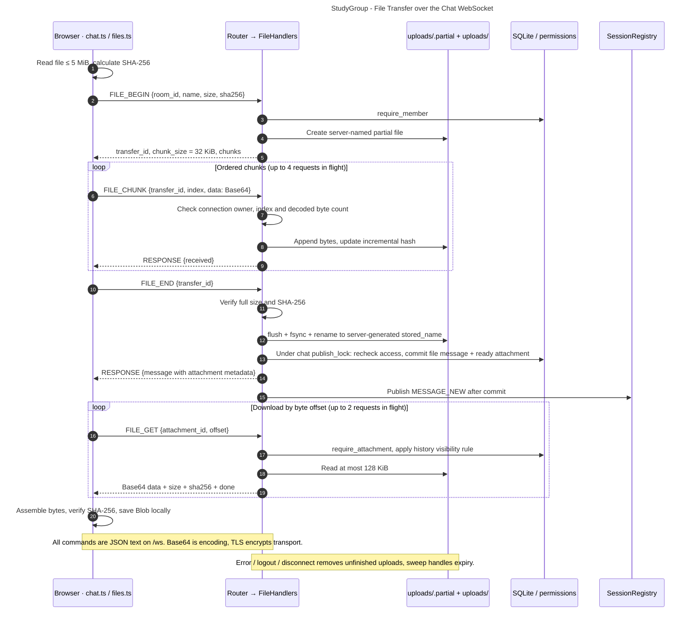

ชื่อไฟล์จาก client เป็น label แสดงผลเท่านั้น ไม่ใช้เป็น path ไฟล์จริงมีชื่อสุ่มจาก server และเก็บใน `uploads/` การ rename บน filesystem กับ SQL transaction ไม่ใช่ transaction เดียวกัน: ถ้า commit ไม่สำเร็จ handler ลบไฟล์ที่ rename แล้ว; startup `FileHandlers.prepare` ล้าง partial และไฟล์ชื่อ server-generated ที่ไม่มี metadata อ้างอิง

SHA-256 ตรวจ integrity ของข้อมูลทั้งก้อน ส่วน Base64 เป็นวิธีใส่ bytes ลง JSON ไม่ใช่การเข้ารหัสลับ การปกป้องระหว่างส่งมาจาก TLS/WSS ไฟล์สูงสุดจริงในโค้ดคือ **5 MiB (5,242,880 bytes)**; upload chunk 32 KiB, download chunk สูงสุด 128 KiB ทุกคำขอยังคงใช้ application envelope และ request ID เดิม

อ่าน: [ChatController.upload/download](../../web/src/chat.ts), [sha256Hex/toBase64/fromBase64](../../web/src/files.ts), [FileHandlers._begin/_chunk/_end/_get/prepare](../../server/handlers/files.py), [add_file_message](../../server/database.py)

ดูพฤติกรรมใน: [test_files_integration.py](../../tests/test_files_integration.py), [history-files.spec.ts](../../web/e2e/history-files.spec.ts)

## 07 · AI summary — slow work แยกจาก connection thread

[เปิดแก้ใน Mermaid Live](https://mermaid.live/edit#pako:eNqNVV1v4zYQ_CsL9yWHyomds-M7PxxgJ7k6weWjcdoAhYGAktY2a4rUkZQdNch_71CSE8dBgT5J4s4Od2eH1HMrMSm3hq12uz3TXnrFQ5r6Ii1_s6bIqU03uZdGC0WjC6rXpkWWCVvOdJXj-GfBOuEzKRZWZDNNJApvdJHFbMNXLqyXicyF9jQm4WhszcaxpVnR6cQDchWd_If3wQ8B_MDxqdGak1AFHdGdKfxH3kmAji4mQqeKrTtcVi_7qLOAmv7-Q3oGU842k86B1u0DL2s62hi7eiv00RZ6HzmqkNovrcllcmvNWqZ1eeP2t28PQ7A8Tv-4uhrdXfx1Ts_WmOxRphHJ9IUOBn1HiZIMnpRFqqTmTyH1AakTpBZ-iZhMhOeUbNDZ-RCfIH42pNMlJytaVDPJOMjtljKPgBQpaj4-PulRv0Nr6WSsGBDnxIKrZs_a9RY3FtWC3POTp19JeC-SZRYK0gJ4LGXsRSq82O472e6bN71GFBeupMKF124HHRmjUrPREWXiCSrrVOoFfdkSXMJfRZxJT3-bmLyhHHg6OG7EdpUC1wYjMmto_xAhYccBUDq0lwiNjSCOLjiUkqC5sE2yFJ42S4l-MT8MzB0GvktsPBoiI8sVez5wpfOchdKlSh-Rn-X-oBpO6DuiMAr3qSplVKcWVikZHzZToNub6T0drbtHW1Xraif397fTOqtudeuIWuEjSJLn0FushVQilkr6kthaY7dVIgf-cvxYH4syorVQEhNgct4WiS-qeQW3uYhw5JjDvPDuhVvhsXWS2zLCKde8obNxEKyRcQiTJNUYa-Ng0EqgrT2vbCng43ONxqH13fn09uZ6ek5Gq5LknBwEq6ZP0qFEqRRC9erbfrWrwTQevjFkwqOGlOKSjJULGS4Zmb4f_ziC9qPbC1pxCXZRuoqdLYKH9D3MOS495BeWSRuPEMwLV-HovFr08D3nJHCeY-KoX-eFhxZQVTviau1V-Mzs2Dx0x0-5wsEHPyxwlHJmgEkZ9K2oleE6ETLFVfo8a2H3jGet4awVC4eXaNaaw63fRSZVWa2PrBQqgk7atdGOnFegKu9P3IYCU3AAPv_PxNzKUPSpUbBSgP3CX_lk_i54DwvuAI573bg32AWMTbgOdiAn_X4v6VSQYKndSHfQ_dKrIo4x53Rv896822yO29rL99F5fz6Yx1VUJN7Y8WrxoeY6UBX0oZYq9t_dwAYMyt0N5_PPafIW3O8zOfka95H8EuakzAa3iPW1-kkBq20nKV3DkfI0FwkuHESO-1iyQq_elnphaekz9UPErMIccXT5pRKr_lvW5JkMR38U2gmguVCOAdpYkTc54UumfonP7iCwNifzSlgcGKx-7jRNva50-y8v8GP4CU9LnTQ8rSIPl0jzl24K-hdutLdn) · [Source](07-ai-summary.mmd) · [SVG](07-ai-summary.svg)

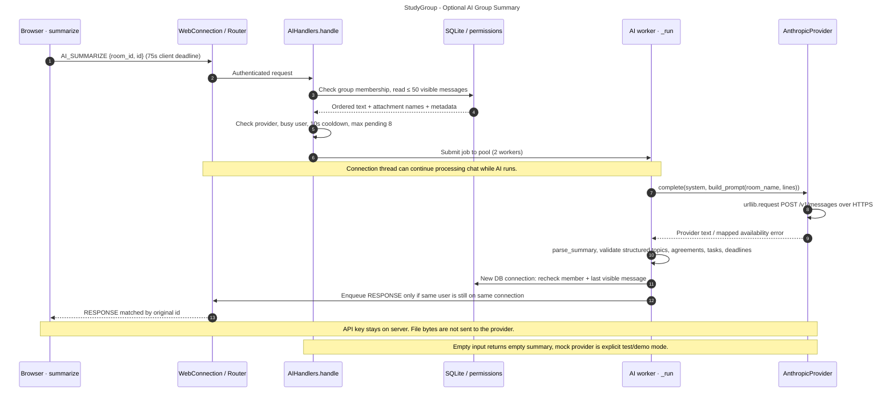

`AIHandlers.handle` อ่านได้เฉพาะกลุ่มที่ผู้ขอเป็นสมาชิกและเลือก 50 ข้อความล่าสุดที่มองเห็นได้ ส่งข้อความ/ผู้ส่ง/เวลา/ชื่อไฟล์แนบเข้า prompt โดยไม่ส่ง bytes ของไฟล์ งาน provider อยู่ใน ThreadPoolExecutor สอง workers มี pending สูงสุดแปดงานและ cooldown สิบวินาทีต่อผู้ใช้

หลัง provider ตอบ `_run` ตรวจสมาชิกและข้อความสุดท้ายซ้ำด้วย DB connection ของตัวเอง แล้วตรวจว่า connection ยังเป็น user เดิมก่อน enqueue ผลลัพธ์ให้ผู้ขอ ไม่มีการ broadcast summary เข้า group และไม่มีตารางเก็บ summaries ใน schema นี้ Browser ใช้ request deadline 75 วินาที ส่วน provider timeout default 45 วินาทีปรับผ่าน config ได้

อ่าน: [ChatController.summarize](../../web/src/chat.ts), [AIHandlers.handle/_run](../../server/handlers/ai.py), [build_prompt/parse_summary/AnthropicProvider.complete](../../server/ai_service.py), [read_ai](../../server/web_config.py)

ดูพฤติกรรมใน: [test_ai_integration.py](../../tests/test_ai_integration.py), [ai.spec.ts](../../web/e2e/ai.spec.ts) การอ้างชื่อไฟล์ทดสอบในคู่มือนี้บอกตำแหน่งตรวจพฤติกรรม ไม่ได้หมายความว่ามีการเรียก paid API ใหม่ในงานนี้

## 08 · Data model — เก็บอะไรถาวร

[เปิดแก้ใน Mermaid Live](https://mermaid.live/edit#pako:eNqNVV1T2zAQ_Csa9zWZIZCPkjdogelQOgyknT5kxnO2zrGKLKWSDE2T_PeeZOPYIUDf7Nu9097tyV5HqeYYTaN-vz9XTjiJU3bvSr66Mrpcsj67RWOFdagcu0MJTmgFkt1QlpyrkIXms4CFgWKuGCst8dlm0-_rNTNaF5ZNWWoQHNqDeFxgkfjYlP3SQgVSlXeYlGrl4BCvQGthgZ5jnTYHjmszUPFAaGKBs2HgHKR5Qe16Wg6tKmv_yNiXb7OLq4s7Jji7va5Cs4ufs0BSUOCBUKy0KUCKv8jZ93bOEqx90obHdFDeilcD4zE4H9zuen1Hw4NQnM2jpRGPlM-0YQtv4zxqcXYan6s8n5as2OV1F6orxb6TWOqntwm5WOQ1o9HcWLcnPWBBf2-_ZqjVhYJyvx_NUHb0R2FFIjGGzFFebSjlNzIaj1-f3r6qfUl-XypRlwfm7fCP88POhMTOrD3wtq3tfXtf3q450tHrrFLYeR57d7s7po1YCLqz8UvjLW0kuV5fzedCORyPxp3K4Err14qGINSix6gNvuqxDKhfXjVMzUS9qEDac8Hpe7KmqeRIB0bTeZSApYfePMro8l5CIeQqxM-MANljFpTtk-ciC6SQ9wMII1ctEdf_mUi7WIBZfdJSm0D7gKc4zjrgjBxpEY6Hg2Q4aRPO6TqiaVHGo9EwPQoUSfvXRgaTwcdhQCzSd4nvHT7MBvXhtJhOdNFslE2yJKCQknfnD4sXmisgCHqhJWCvd6O0QyrZPjDLTni6A_f7TMenyYiSt94nuuppDsZV009L89g4KWxdg-P9ElJaCEKORxQyoB52oaEP5a6QXyFB6X10psRtGNbvElWKVfFCGKPNmW_HkzKQFon0ZGBZ5_g3wV1Or4OJr1pfgxswtNkUPTmqm2oig9F2S_sIpdP3K5XWdaJyyekC1r-rWtA_pEVNjw) · [Source](08-data-model.mmd) · [SVG](08-data-model.svg)

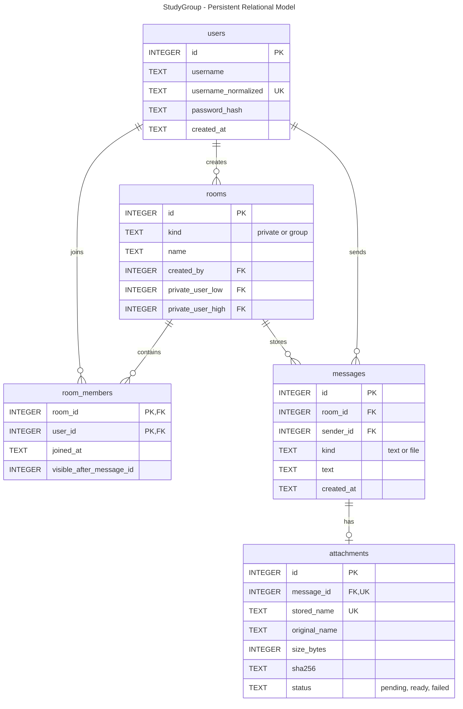

ภาพแสดง logical core ของ [schema.sql](../../server/schema.sql) โดยเลือกคอลัมน์หลัก ไม่ได้แทน DDL ทั้งฉบับ `messages(room_id,sender_id)` มี composite foreign key ไป `room_members(room_id,user_id)` เพิ่มจาก FK รายตัว; private room มี unique pair `(private_user_low,private_user_high)` และ trigger กันสมาชิกที่ไม่ใช่คู่นั้น `attachments.message_id` เป็น unique FK และมี trigger ให้ผูกกับ message ชนิด file เท่านั้น

attachment หนึ่งชิ้นผูกกับ message หนึ่งรายการและอ้าง bytes ด้วย `stored_name`; metadata ไม่ส่ง stored path ออกไป client ส่วน `visible_after_message_id` เป็น boundary ที่เก็บเป็นตัวเลข ไม่ใช่ FK ไป message (ค่า 0 ใช้แทนยังไม่มีข้อความ)

Memory ที่ไม่อยู่ใน ER: online sessions, resume digests, outboxes, transfer progress, AI jobs และ UI state ส่วน `schema.sql`/`Database.initialize` เปิด foreign keys, WAL และ schema version; transaction details อยู่ใน [database.py](../../server/database.py)

ดูพฤติกรรมใน: [test_database.py](../../tests/test_database.py), [test_permissions.py](../../tests/test_permissions.py), [test_data_backup.py](../../tests/test_data_backup.py)

## 09 · Reading roadmap — ตามหนึ่ง action ให้จบก่อนขยาย

[เปิดแก้ใน Mermaid Live](https://mermaid.live/edit#pako:eNqNV2tv2zYU_SuE-2UPx44dO2mNoYCbpGuABhlsd8MwDwZFXUVcJFElKbtGm_--Q4r0I82QfQlk3XN5n-dQ-doRKqXOpHNycrKsrLQFTdjcNun2V62amp2wmeJpyWuWKc1mxFNZ3TObE7uE37LyblmhNiLn2rLFu2XFmLF4_mvZmS-mswVbNqenyQWbXU-vbq97Zcp-ZqkSps-1yKUlYRtN_V8S3X_7qUpJw7lKmW6QTEnMPYtcKUNMVcQaQ5pxYaWqlp2_XSyhKqvxBuEGu1BI0-cYjf50gwwp7ZdkDL-nld3WZHr1FumseSFT7g7Fb4_dUNI3WvRbkDUx51orq4QqUEaI30hEHsbI72XVRj5I9OjAaV3juC_ADwdvhuwy5_bSJamKAg6yQrHcAhFO30hNOP9sdz5wauNboelzQ8aymysfYKF5ZWqlbS8aQoj-xsTHlNywV6ED3m2mGku6l0pTcytylwEyX5Pu69ZSb0MqvLE5Upl-WnxgwObePcd8kDiGCatrZohUc2M2SqcmNlRzS6tCltIeoAwSQYPMPoirHkFmd3e3rM9ur-fz6a_Xz4TzXdofhOHxhBuK0eomKaTJV4USDxGj6V4aq7e9YAwRc7xUeougH27mi7vZn4g7v57OLp-rMoCPSnBrHFtqPDwhcIVW0m36PwodXUsjE1lIG8vMZEEGId_ffDyoLoyeNXUBzvVTtancQwzlnWKFftwZVmbXcG0lL-JPoUq0Ok7Orej05rmpyYNSMK8HHLgC9TyKy5VbBSnoAPRhsfhtzkCDtQRXYwAhUD-CjOKeXn-pC47KN7ligrudIk8LN6h2QqRLuZv-rpsip5L3zOfimcmGYJqw5pVxtBg_oYWLAHNTWJZw8dA2VVUVeR72qAIxGopH_0HJ5d4Yq97zSFVhqvum7oga3kBohN2tLokH14Tz72QooZyvJfSzxfg4FhQ1ffd3BW1odSgj7sQQJLR0r70gMY_bSQgNqf9Tz9Qk9hqhahf1IkY9FlFsc0rYpy0eNOgPZu8UboWCMnnf9t_7XoEvpN2ixTdrKHQv4EIeXgg1l8WGb52cB6QRWtYoyU1s5drf1Puh-RuBnZy8_bbsFKBMhWVEKMvWSvCkKbgG8ttOrw-FPXi5Z2KZVqVvKaIRVc6nka0MB1zWrkIQwR-cgHf9Fv3owE5Po64GB0MFViD23oGclr0IcmR9ERT04kWcp_bLecmowwECCrore-tvSZBQ4dJkLiKW1jt4XkZdDU4llQkWJJd1e7l6pTDH8JB38PDyVThqYZ9r3KFSQM2PPXwFAc-t5SIvkduR8h3CeRyX1wFrKcXS1431KWFPHU-eePinWHjlKGCBRG8qOF8t7hw8asOhTgQXv8O6ZJSC0AKKYtopOkLu6fvkfKrWUjsdqKxDg2keWuB2u6IMZtwnrvRi8ore0HmWdXHDqAeavDofj0fitItPBaUnr4ajQTK6OPKNXA_eo2xw4H02unidnEfvwfBsMKIjb7fQ0XWcjSnduw5fD8_PDlyTodi5tjzsRmp1G9l1G9fd9cpXtIe7Xeu63emGjej6OXcxvriXe6wfULftYxet8kkuq04XK6dLLlN8ZX4FkSHxWJ7JsuN0fdnpOs5W9j0vZbH176caN1mXGQjxCW4gmXmQ9_udw5Y4snQmX_-nY61lCX25dB3xsDCrQ-OCvtgDQJjXAeAdPmZIH0DaAXtIISs6tAwuBq9H3mKguFX6JLgfdVsSuUv7yJqNs4ss8VYMSOl3D_ff5dwafELf5eJt_11NpSzhyMOAWXaWir3xaZ3i_E0yhvOjm1P8zm-7Lxp8KMZJShPOSGkObcd_CbAMx3iFC_Vh_2rkXuW2LD7yhAo3R6sbevTNgmRXgtrDS6m10lNXjgNlvDAE0EbzOvi4XzKFVHcmgwt3ariub7m-l7gaJmenoajdm8H48RH7iLVW820lwjmdpsaq0pXkuHTLkNC_rM9-iQ) · [Source](09-reading-roadmap.mmd) · [SVG](09-reading-roadmap.svg)

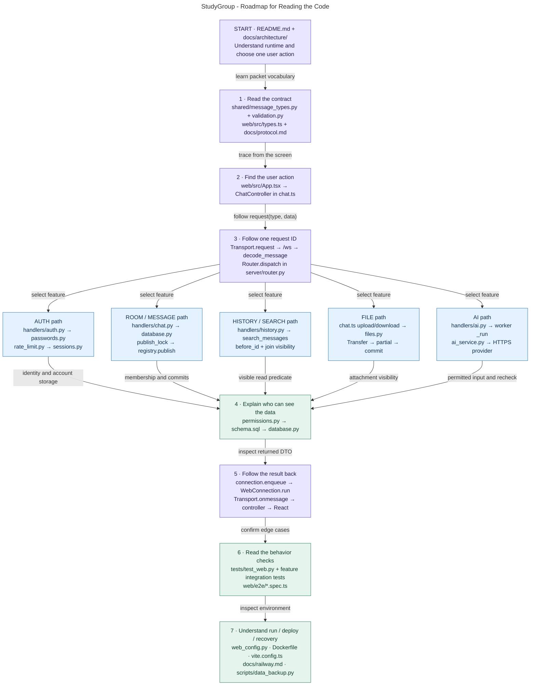

สำหรับคนเพิ่งเข้ามา แนะนำ trace **ส่งข้อความหนึ่งครั้ง** ให้จบก่อน: `App.tsx → ChatController.send → Transport.request('MESSAGE_SEND') → WebConnection.run → decode_message → Router.dispatch → ChatHandlers._handle → add_text_message/permissions → COMMIT → enqueue/publish → Transport.onmessage → addMessage → React` แล้วจึงย้อนดู auth, history, files และ AI

เมื่ออ่านแต่ละเส้นทาง ลองตอบให้ได้ว่า **actor มาจากไหน, payload ถูกตรวจตรงไหน, transaction จบเมื่อไร, ใครมีสิทธิ์เห็นผล, และถ้าหลุดก่อน ACK จะเกิดอะไร** คำตอบอยู่คนละ module จึงต้องอ่านเชื่อมกันตามลูกศร

### เลือกไฟล์จากอาการที่ต้องตาม

| อาการ/งานที่สนใจ | เริ่มอ่าน | ตามไป |
| --- | --- | --- |
| request ค้าง / ตอบผิดคำขอ | `transport.ts` pending map + timeout | `WebConnection.run`, enqueue/outbox, handler |
| refresh แล้วต้อง Login / แท็บโดนแทน | `session.ts`, `restoreSession` | `SessionRegistry.resume`, token expiry/restart |
| ห้องหาย / รายชื่อกลุ่มไม่อัปเดต | `refreshGroups`, `loadPrivateRooms`, `event` | `GROUP_LIST`, `GROUPS_UPDATED`, pagination |
| ข้อความซ้ำ / draft หาย | `send`, `merge`, `addMessage` | response + sender echo, `message_id` |
| เห็นประวัติหรือไฟล์เกินสิทธิ์ | `permissions.py` | `search_messages`, `require_attachment`, recipient lookup |
| ไฟล์ส่งไม่ครบ / hash ไม่ตรง | `upload/download`, `files.ts` | `FileHandlers`, partial cleanup, commit |
| AI ช้า / ไม่ตอบ | `summarize` request deadline | pool/cooldown, provider timeout, response recheck |
| Restart แล้วข้อมูลหาย | `web_config.py`, data path | Volume, `Database.initialize`, backup/restore |

## 10 · Deployment — แยก network topology ตามสภาพแวดล้อม

[เปิดแก้ใน Mermaid Live](https://mermaid.live/edit#pako:eNqNVm1v2zYQ_iuE-mXD7MjvTp2hgNOkawA39mo3wVYPA0WebCISqZGUXaHNf9-RerHyMmDIh9i8e-6ee-6O9PeAKQ7BLOh2u1tphU1gRtY258VvWuUZ6ZKFYjTpkCs4QKKyFKQlVHLyGZjSHPADFcmRFuiQJapw9q30weJEHdmeaks2l1tJiMmjnabZnrBE5fzrNvg8v1ncz_8g27zXi6bEqkwlalcQXYcWknDFTKjLFGcpJ0qSKblVBzLoDSbb4C8XmJBIq6MBjTG_4L_6a2MGvgOXr2Ka5VEimD_9NdLhu81iTSzoVEhqhZINjGYZopYSyKqwe8ycacXAGBIiDUCaGYahPgRmO4A-O0LkGPbO_N_svNfrefPamQ1qRpklUS4S7jUMj6ZJdlBJnsLXn7bBCrQRxjqhy8NaoBAJhZzaKqVr0s416YxH5BeSo_yUm3Ab_Fzzl3avVSYYVjGvP5P56sbjl5krliauqoPgLbkiyh5yV7phWmTW-Jx_l6dnWVFW9PtCWCBG0szslcX8GigvCLWWsr2bAuP97kCLWGAv_7xZ-ZrXH-fdwfhF60i3--7HNvi42azWhBoD1mDM-_WaMJWmCESlfviWnVrawmBL7tc4LwYLIa4ZgoEDoGJNLyt3ZI6RY5GAKVDllNyES-daav3cuyQUHvphip2nO_A8GmXbvasQTgckLese1hI5XKmhA4HkT3YicVuGki-W7-eLuuEcYponFo0qc9ALouqmcYFbgpuFoxsrTRbz20ZRH-qy2YjLZ8vgzXM_2q2prTL2B1M_u_3T7KI15FgLiobz-nR0XHoG2oYPULyav6VieL--IF7O0LX1uAdZ4pWMxS7XwJ1CNbvXNOJwQNIfPi9vN9e3V-Tq-u56sVx9ur7d1PTvcCYbHuj-QoXa0afZK2Nn4_50eFpCxKOzC-PgpBTI11zurlG5ZoBSuJnX4Dauna-UtbotXqRqJL2HaK3YA1iyx8lOcN9fId2e7i83pfp-Tl2NDdvKa6XVt8J5XOA6g6eN9P7JAfu21GInpIOWDFvSsgRX7QriqlC3FcnsDYzifhx3jNXqAWZvhqPpeTTpMLyc9exNfzDsj-Ap2CqNm1Gjx_EY-Ak9OB9Mhi10NGBP0CwRbk0q8FuYtFJPxuMR69XgwagfjaZPwPANL243iSU8juM-Zw08mk6jwbiGj-lw0qMN3C15px63TilNx0na8XdLqcjJu9zxTrnBdcknc3WNddrD32k1s6yylby5j-sStjLoBCk-Q1RwfI-_bwO7B7yQgtk2iKjBD51tECtpP9BUJIU_n2vh3mZDpekad9N6J4-7o2iLEndfzb7_T2CmRUp18d7p5d2qfrSNG-Tbcqh60nK4dG-3brmUTfQuiZDQtvSn_fORtxh88yV_ltzPYVkSXjLiqTUex9M48lbcTKUvH3YvOJcGT-gFF2_772qksoAh2wnjeMjZyfi8TjZ5G40R_Oj6VP_2KdVnOQ5T3Ulhqhgc1hllQjreOKb4dFD5cDoauaO9TZMFjSBxfbQ6h0cvFm62dC-cC54KrZWeu3KcU0wTA-h0xDuzwrhvgts9fu1PXdTqLftEtb8ZZsNeVVRz0h8_PuI80tyqdSFZFSfIM_wtAFeC4o2cVoT-BSnLbsw) · [Source](10-deployment.mmd) · [SVG](10-deployment.svg)

```mermaid
---
title: StudyGroup - Local, Development and Recorded Railway Deployment
---
flowchart TB
  subgraph cloud["RAILWAY · topology recorded in docs/railway.md on 7 Nov 2026"]
    browser["User browser"]
    edge["Railway public edge<br/>TLS termination"]
    app["One Python process / one replica<br/>server.web on 0.0.0.0:8000<br/>Serves React build and /ws"]
    volume[("Persistent volume · /app/data<br/>studygroup.db + uploads/")]
    anthropic["Anthropic API<br/>Optional provider"]
    backup["scripts/data_backup.py<br/>SQLite snapshot + ready attachments<br/>Verified ZIP and SHA-256"]
    browser -->|"HTTPS assets + WSS commands"| edge
    edge -->|"HTTP / WS inside service"| app
    app -->|"SQL + filesystem I/O"| volume
    app -->|"HTTPS /v1/messages"| anthropic
    volume -->|"read consistent snapshot"| backup
  end
  subgraph local["LOCAL · default loopback; optional direct TLS for LAN"]
    localBrowser["Browser"]
    localApp["server.web · 127.0.0.1:8000<br/>web/dist + /ws<br/>Optional TLS cert/key"]
    localBrowser -->|"HTTP/WS; HTTPS/WSS when TLS configured"| localApp
  end
  subgraph dev["FRONTEND DEVELOPMENT · Vite"]
    devBrowser["Browser · localhost:5173"]
    vite["Vite dev server<br/>React source + hot reload"]
    devApp["Python · localhost:8000<br/>WebSocket handlers"]
    devBrowser -->|"HTTP UI + /ws"| vite
    vite -->|"Proxy /ws; preserve request Origin"| devApp
  end
  classDef server fill:#e4f1ff,stroke:#3478b6,color:#12314e
  classDef storage fill:#e5f5ed,stroke:#328263,color:#123b2c
  classDef client fill:#e9e6ff,stroke:#6554c0,color:#241b47
  classDef external fill:#fff1dc,stroke:#b77b25,color:#5a360a
  class app,localApp,devApp,vite,edge server
  class volume,backup storage
  class browser,localBrowser,devBrowser client
  class anthropic external
```

Local ที่ build แล้วใช้ Python เสิร์ฟ UI และ `/ws` ที่ port 8000 ใน development ใช้ Vite ที่ 5173 แล้ว proxy `/ws` ไป Python ที่ 8000 Browser เลือก WS/WSS จาก URL ปัจจุบันจึงไม่ต้องกรอก server address ในหน้า Login

Railway topology อ้างอิง [docs/railway.md](../railway.md): public HTTPS/WSS จบที่ Railway edge แล้วส่ง HTTP/WS เข้า Python หนึ่ง replica ที่มี persistent volume `/app/data` ภาพนี้ไม่ใช่ผลตรวจ live deployment รอบใหม่ การเพิ่มหลาย process/replicas ต้องออกแบบ session registry/event distribution ใหม่ เพราะปัจจุบัน state นี้อยู่ใน process เดียว

Backup ใช้ SQLite online backup API แล้วคัดลอกเฉพาะ ready attachments ที่ snapshot อ้างถึง ตรวจขนาด/SHA-256 ก่อนออก ZIP การ restore ใช้ destination ใหม่และตรวจ inventory/SQLite integrity ตาม [data_backup.py](../../scripts/data_backup.py) แทนการเขียนทับฐานข้อมูลที่กำลังทำงาน

อ่าน: [Dockerfile](../../Dockerfile), [WebConfig](../../server/web_config.py), [vite.config.ts](../../web/vite.config.ts), [setup](../setup.md), [Railway/backup guide](../railway.md)

## ขอบเขตการตรวจและวิธีแก้ภาพต่อ

แผนภาพและคำอธิบายตรวจเทียบกับ implementation ที่ commit ด้านบน; `.mmd` ทุกไฟล์ผ่านการ render ด้วย Mermaid CLI 12.2.0 และภาพ overview ตรวจใน Mermaid Live ด้วย งานนี้แก้เฉพาะเอกสารและแผนภาพ ไม่ได้เปลี่ยน runtime ของแอป

ใช้สกิล [c4-architecture ของ softaworks/agent-toolkit](https://skills.sh/softaworks/agent-toolkit/c4-architecture) โดยแบ่ง Context/Containers ออกจากรายละเอียด module และเส้นทาง runtime เพื่อไม่ปนระดับ abstraction

เมื่อต้องอัปเดต: แก้ source `.mmd` ที่ต้องการ → เปิด Mermaid Live และวางโค้ด → ตรวจภาพจริง → ส่งออก SVG ใหม่ → ปรับภาพ/ลิงก์/เนื้อหาที่เกี่ยวข้องในคู่มือและ gallery ให้ตรงกัน ไฟล์ source อยู่ข้างคู่มือนี้และไม่ขึ้นกับ external rendering service ในการเปิด gallery
