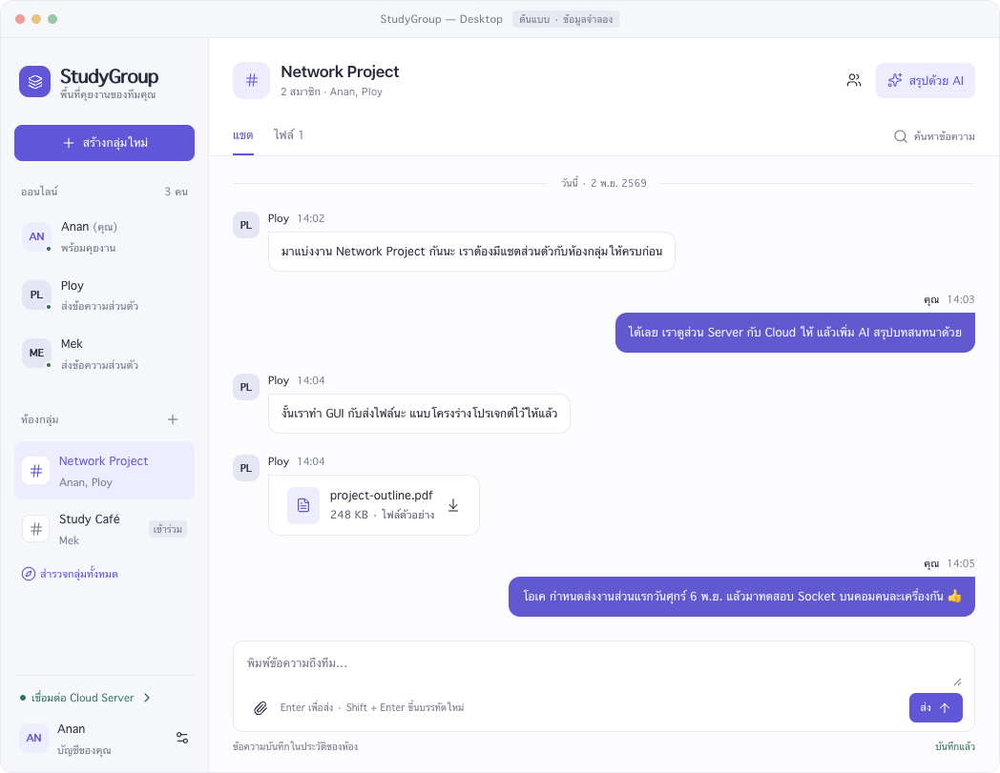
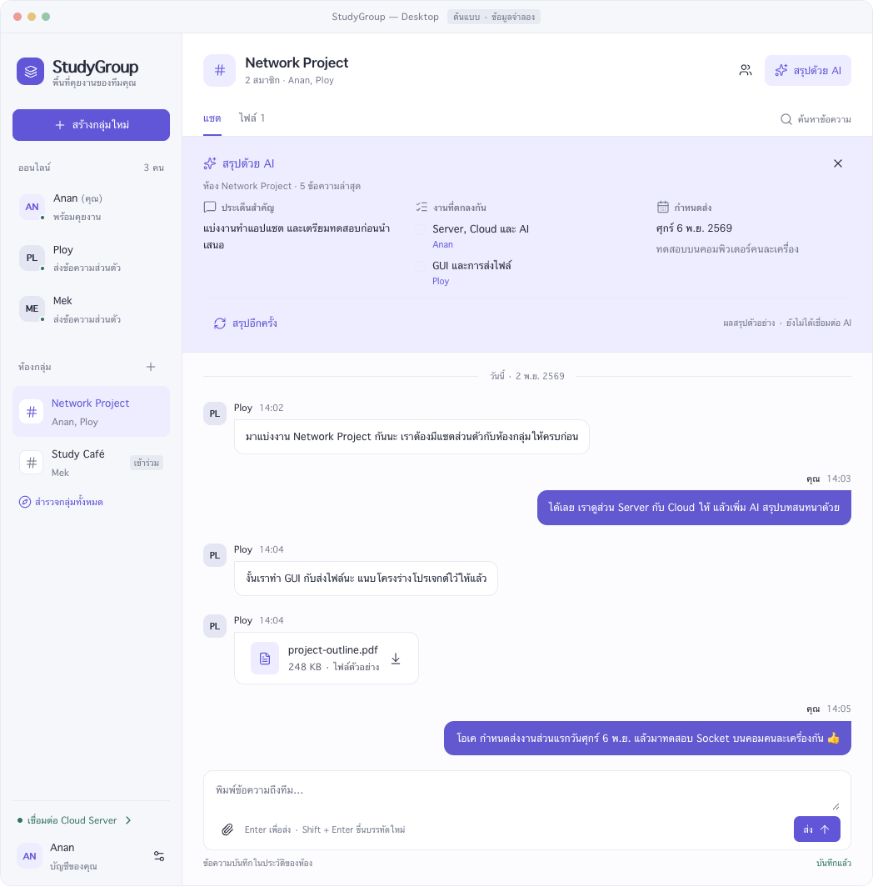
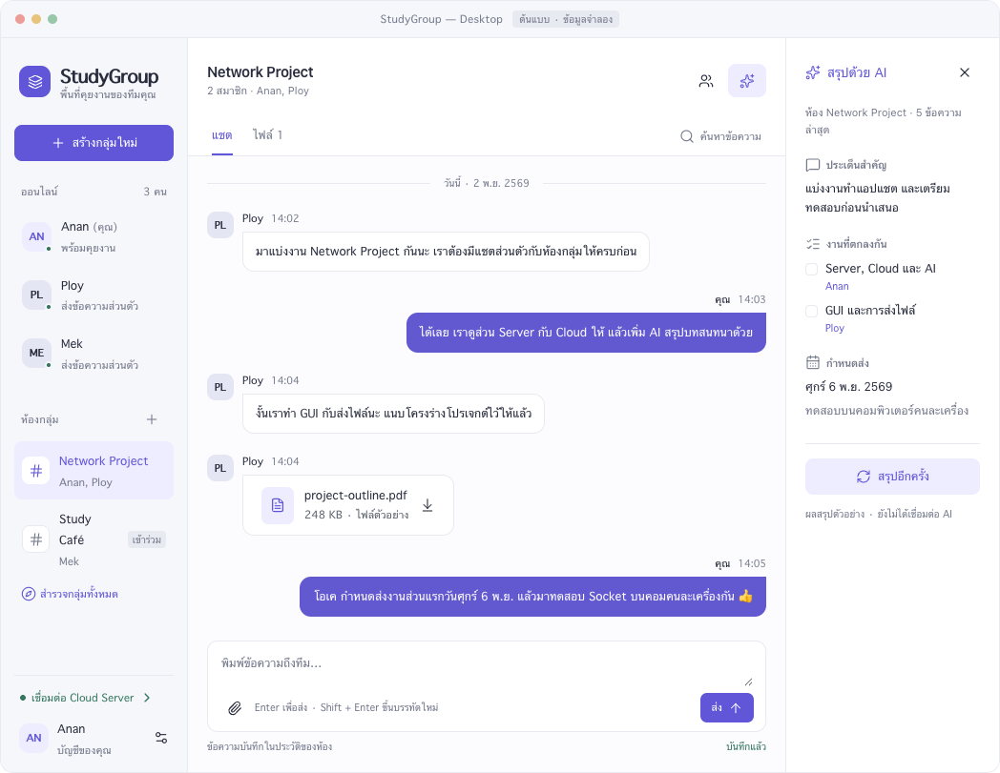

# StudyGroup Desktop Prototype

เปิด [studygroup-desktop.html](studygroup-desktop.html) ใน Browser โดยตรง แล้วเลือก Focus หรือ Workspace จากตัวเลือกด้านล่าง ไม่ต้องติดตั้งหรือรัน Server

## แบบหน้าจอ

- **Focus:** แบบเริ่มต้น Sidebar ซ้ายและพื้นที่แชตหลัก เปิดแผง AI เมื่อต้องการ
- **Workspace:** เพิ่มแผงสรุป AI ทางขวาเมื่อหน้าต่างกว้าง
- ทั้งสองแบบเป็นทางเลือกการจัดวางของแอปเดียวกัน ไม่ใช่ข้อกำหนดให้สร้างสองโปรแกรม

## ทดลอง Flow

1. กด Ploy หรือ Mek เพื่อเปิดห้องส่วนตัว พิมพ์แล้วกดส่ง หรือ Enter
2. เปิด Network Project เพื่อดูแชตกลุ่ม ไฟล์ และปุ่มสรุป AI
3. กดสร้างกลุ่มใหม่ จะมี Anan คนเดียวเป็นสมาชิกเริ่มต้น
4. เลือกสำรวจกลุ่มทั้งหมดหรือ Study Café แล้วกดเข้าร่วมด้วยตัวเอง
5. กดค้นหาข้อความ เช่น `กำหนดส่ง` หรือกรองวันที่ `2026-11-02` แล้วกดผลลัพธ์เพื่อเน้นข้อความ
6. เลือก Tab ไฟล์ กดไฟล์ตัวอย่างเพื่อเปิดรายละเอียด หรือเลือกไฟล์แนบไม่เกิน 5 MiB
7. กดสถานะ Cloud เพื่อดูตัวอย่างการตั้งค่าการเชื่อมต่อ
8. กดบัญชี Anan แล้วเลือกคืนค่าบทสนทนาตัวอย่างเพื่อเริ่มใหม่

## ขอบเขตที่จำลองไว้

ไม่มี Backend, การรับ–ส่งข้อความข้ามเครื่อง, Authentication จริง, SQLite, การอัปโหลด/ดาวน์โหลดจริง, AI API หรือ Cloud connection ข้อมูลอยู่ในสถานะของหน้า Preview และอาจจำไว้เฉพาะ Browser/Preview เดิม ห้ามถือเป็น Database ของแอป

เลือกไฟล์แล้วต้นแบบแสดงเพียงชื่อและขนาด ไม่มีการอ่านเนื้อหาหรือส่งไฟล์ออกไป ผล AI เป็นตัวอย่างที่เตรียมไว้ ไม่ได้วิเคราะห์ข้อความที่เพิ่มใหม่ สถานะส่ง/บันทึก/ออนไลน์เป็นสถานะจำลอง

หน้าจอ Login/Register ยังต้องออกแบบและพัฒนาตาม HANDOFF.md บัญชี Anan/Ploy/Mek และวันเวลาในหน้าเป็นข้อมูลตัวอย่าง แอปปัจจุบันใช้ React ใน Browser ตามคำสั่งผู้ใช้ 6 พ.ย. 2026
ใช้ Focus เป็นแบบอ้างอิง ไม่วาด title bar จำลองในหน้าเว็บ
เปิดแอปจริงตาม [setup.md](../setup.md); ไฟล์ใน directory นี้ยังเป็น Prototype

## ไฟล์สำหรับแก้ไขและส่งต่อ

- `studygroup-desktop.fragment.html` เป็น Source ที่อ่านและแก้ไขได้
- `studygroup-desktop.html` เป็นไฟล์ Preview ที่รวม Wrapper และตัวเลือกแบบหน้าจอไว้แล้ว
- `studygroup-*.png` เป็นภาพอ้างอิงที่บันทึกจาก Preview

ไฟล์ Preview เปิดดูได้โดยไม่ต้องอาศัย Chat เดิมหรืออินเทอร์เน็ต ไม่มีการเรียก API ภายนอก ตัวเลือก Layout และปฏิสัมพันธ์หลักทำงานในไฟล์ Preview โดยฝัง Lucide จาก Runtime ที่ใช้สร้างไฟล์ไว้แล้ว ดูสิทธิ์ใช้งานใน `THIRD_PARTY_NOTICES.txt`

หากแก้ Fragment ให้สร้าง Preview ใหม่ตามขั้นตอน Export ของ Visualize แล้วตรวจทั้งสอง Layout และ Flow หลักอีกครั้ง การแก้ Preview เพียงอย่างเดียวจะไม่อัปเดต Fragment ตัว Export ปกติอาจอ้างอิง Library ผ่าน CDN หากต้องรักษาการเปิดแบบ Offline ต้องฝัง Lucide พร้อม License และตัดตัวโหลด Tooltip ภายนอกที่ไม่ได้ใช้เช่นเดียวกับไฟล์ที่ส่งมอบนี้

## การตรวจไฟล์ส่งต่อ

ตรวจการเปิด Preview แบบปิดเครือข่ายและการใช้ชื่อ StudyGroup แล้ว ทดสอบปุ่มสลับ Focus/Workspace การส่งข้อความจำลอง แผง AI ค้นหา สร้างกลุ่ม เข้าร่วมกลุ่ม แนบไฟล์และรายละเอียดไฟล์ รวมถึงขนาดหน้าจอเล็กและธีมมืดโดยไม่พบข้อผิดพลาด JavaScript การตรวจนี้ครอบคลุมเฉพาะ Prototype ไม่ใช่การทดสอบ Backend หรือการใช้งานจริงตามเกณฑ์ Term Project
